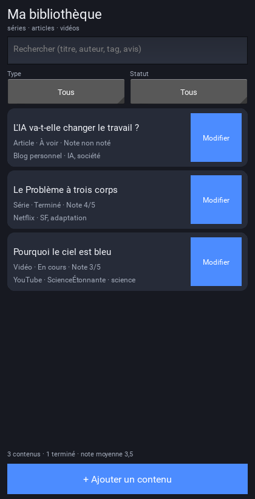
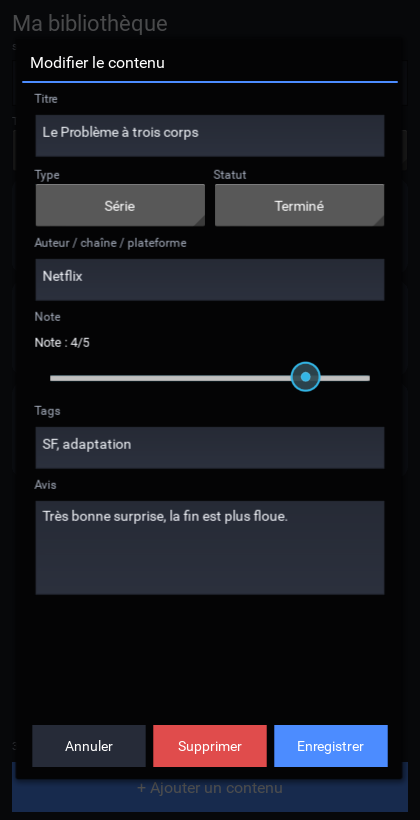

# Ma bibliothèque — version Android (APK)

Application Android pour garder une trace des **séries**, **articles** et **vidéos** que tu regardes ou lis : titre, type, auteur/chaîne/plateforme, statut, note de 0 à 5, tags et petit avis. La recherche, les filtres et les statistiques sont aussi de la partie.

## Aperçu

Écran principal (données d'exemple) :



Formulaire d'ajout / modification :



## À savoir avant de commencer

- La version pour ordinateur utilise **Tkinter**, qui n'existe pas sur Android : c'est pour cela que l'application Android a été réécrite (avec **Kivy**).
- Un APK doit être compilé sur **Linux** avec le SDK Android. Ce PC (Windows, sans WSL, sans Docker, sans SDK) ne peut pas le faire, et Kivy n'est pas disponible pour le Python 3.14 installé.
- La compilation se fait donc **gratuitement dans le cloud**, sur GitHub Actions : tu envoies les fichiers, GitHub compile, tu télécharges l'APK. **Rien à installer** sur ton PC.
- Il faut juste un **compte GitHub gratuit** (2 minutes).

## PC ou téléphone ? Où faire quoi

| Étape | Où | Pourquoi |
|---|---|---|
| 1. Créer le dépôt | **PC** (ou téléphone) | le compte est le même partout |
| 2. Envoyer les fichiers | **PC** | les fichiers sont sur le PC ; le glisser-déposer marche mal depuis le téléphone |
| 3. Compiler | PC ou téléphone | tu peux suivre la compilation depuis n'importe quel navigateur |
| 4. Télécharger l'APK | **PC** de préférence | Android dézippe mal les archives |
| 5. Installer | **Pixel** | l'APK se transfère par câble USB ou Google Drive |

Le compte GitHub est le même sur les deux appareils : tu peux tout préparer sur l'ordinateur, puis installer sur le téléphone.

## Contenu du dossier

```
bibliotheque-android/
├── main.py                  ← l'application (interface Kivy)
├── donnees.py               ← sauvegarde / lecture des données
├── buildozer.spec           ← réglages de l'application Android
├── build-apk.yml            ← copie de secours du script de compilation
├── LISEZMOI.md              ← ce guide
└── .github/workflows/build-apk.yml   ← le vrai script de compilation
```

## Étape 1 — Créer le dépôt GitHub

1. Ouvre <https://github.com/new> (crée un compte gratuit si tu n'en as pas).
2. **Repository name** : `bibliotheque-android`
3. Choisis **Public** (compilation illimitée) ou **Private** (2000 minutes gratuites par mois, largement suffisant).
4. Ne coche **aucune** case (« Add a README », « Add .gitignore », « licence »).
5. Clique sur **Create repository**.

> À faire de préférence sur le **PC** : le dépôt se crée en une minute, et c'est aussi là que se trouvent les fichiers à envoyer à l'étape 2.

## Étape 2 — Envoyer les fichiers

1. Sur la page du dépôt, clique sur **Add file** → **Upload files**.
2. Ouvre le dossier `bibliotheque-android` sur ton PC. Sélectionne **tout** (`main.py`, `donnees.py`, `buildozer.spec`, `build-apk.yml`, `LISEZMOI.md`, le dossier `apercus` et le dossier `.github`), puis glisse **le contenu** dans la zone de dépôt — pas le dossier `bibliotheque-android` lui-même, sinon GitHub crée un sous-dossier et la compilation ne part pas.
3. Vérifie que `.github/workflows/build-apk.yml` apparaît dans la liste.
4. Clique sur **Commit changes**.

> **Si le dossier `.github` n'apparaît pas** : clique sur **Add file** → **Create new file**, tape comme nom `.github/workflows/build-apk.yml`, puis copie-colle le contenu de `build-apk.yml` (sans les deux lignes de commentaire du début), et clique sur **Commit changes**. La compilation fonctionnera pareil.

## Étape 3 — Laisser GitHub compiler

1. Va dans l'onglet **Actions** du dépôt.
2. Si GitHub propose d'activer les workflows (« I understand my workflows, go ahead and enable them »), accepte.
3. La compilation **Construire l'APK** démarre automatiquement. Sinon, clique sur **Construire l'APK** puis **Run workflow**.
4. Compte **30 à 50 minutes** la première fois (GitHub télécharge le SDK et le NDK Android, environ 5 Go). Les fois suivantes sont plus rapides (5 à 15 minutes).
5. Attends que le rond passe au **vert** ✅.

## Étape 4 — Télécharger l'APK

1. Ouvre l'exécution terminée (celle avec le rond vert).
2. En bas de la page, section **Artifacts**, clique sur **apk-bibliotheque**.
3. Tu télécharges un fichier `.zip` : dézippe-le sur le PC, il contient un fichier `.apk`.

## Étape 5 — Installer sur le Pixel

1. Transfère le `.apk` sur le téléphone (câble USB, Google Drive, etc.).
2. Ouvrez-le avec l'application **Fichiers**.
3. Android demande d'autoriser l'installation : **Paramètres** → **Applications** → **Accès spéciaux** → **Installer des applis inconnues** → autorise l'application utilisée (Fichiers / Chrome).
4. Appuie sur **Installer**. Play Protect peut afficher « Installer quand même » : c'est normal, l'APK est signé avec une clé de test (ce n'est pas l'APK d'un inconnu, c'est le tien).
5. Ouvre **Ma bibliothèque** depuis l'écran d'accueil.

## Utiliser l'application

- **+ Ajouter un contenu** : ouvre la fiche (seul le titre est obligatoire).
- **Modifier** sur une fiche : change ce que tu veux, puis **Enregistrer**.
- **Supprimer** dans la fiche (une confirmation est demandée).
- **Note** : fais glisser le curseur de 0 à 5 (0 = non noté).
- **Recherche** : tape un mot ; **filtres Type / Statut** pour trier.
- **Statistiques** en bas : nombre de contenus, terminés, note moyenne.

## Où sont mes données ?

Elles sont enregistrées dans un fichier JSON **privé de l'application**, sur le téléphone. Aucune connexion Internet n'est utilisée.

> Attention : **désinstaller l'application efface ses données**. Une sauvegarde export/import pourra être ajoutée plus tard si tu en as besoin.

## Mettre à jour l'application plus tard

1. Remplace les fichiers sur GitHub (mêmes étapes d'envoi).
2. La compilation repart toute seule.
3. Installe le nouvel APK **par-dessus** l'ancien. Si Android refuse (« application non installée »), il faudra désinstaller l'ancienne version… et tes données seront perdues : dans ce cas, ne désinstalle qu'après avoir ajouté la sauvegarde.

## Si la compilation échoue

Ouvre l'exécution rouge, clique sur l'étape « Construire l'APK », et envoie-moi les **20 dernières lignes** du journal : je corrige la configuration.

## Si GitHub est un blocage

Dis-le-moi : je peux préparer une autre voie (version web installable dans Chrome, sans compte GitHub, une fois hébergée gratuitement).
